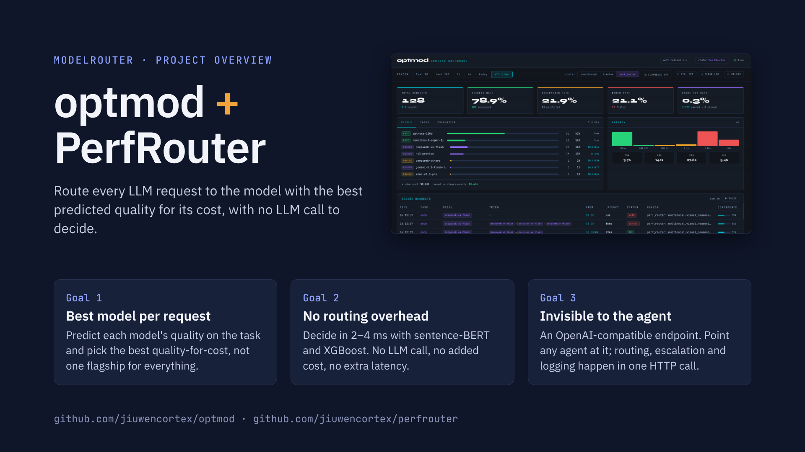
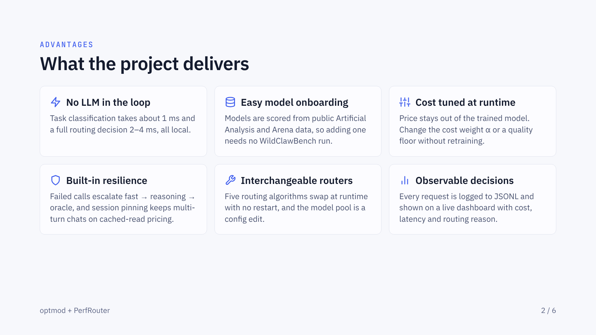
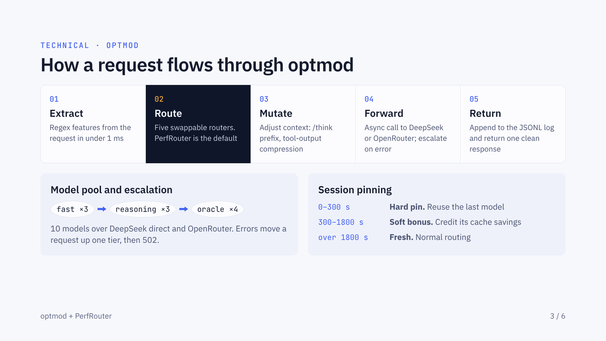
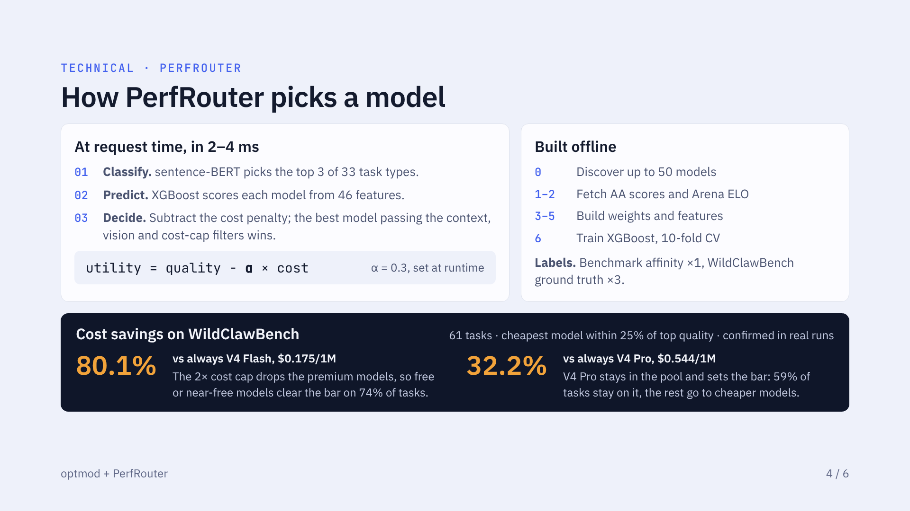
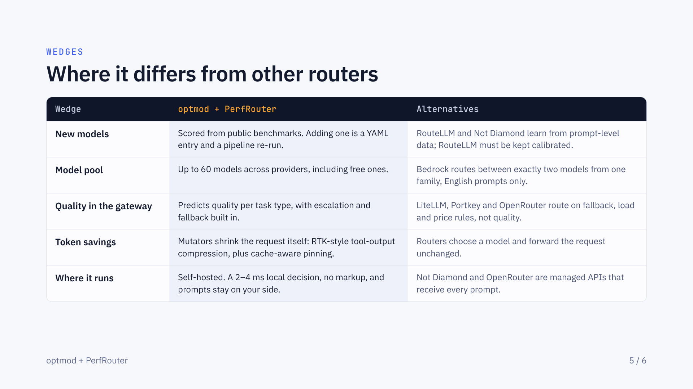
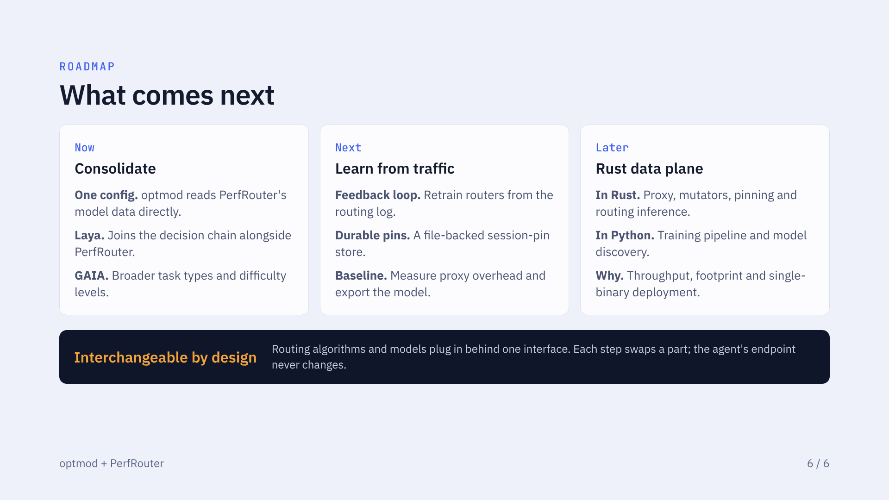

# optmod + PerfRouter — project overview deck

A six-slide overview of optmod and PerfRouter: goals, advantages, how a request flows through optmod, how PerfRouter picks a model, where the project differs from other routers, and the roadmap.

- [`optmod-perfrouter-deck.pdf`](optmod-perfrouter-deck.pdf): the deck as a PDF (1920×1080 pages).
- [`optmod-perfrouter-deck.html`](optmod-perfrouter-deck.html): a self-contained page with every slide and its speaker notes. Download it and open it in a browser; fonts and images are embedded.
- [`slides/`](slides/): one PNG per slide, shown below.

| | |
|---|---|
|  |  |
|  |  |
|  |  |
